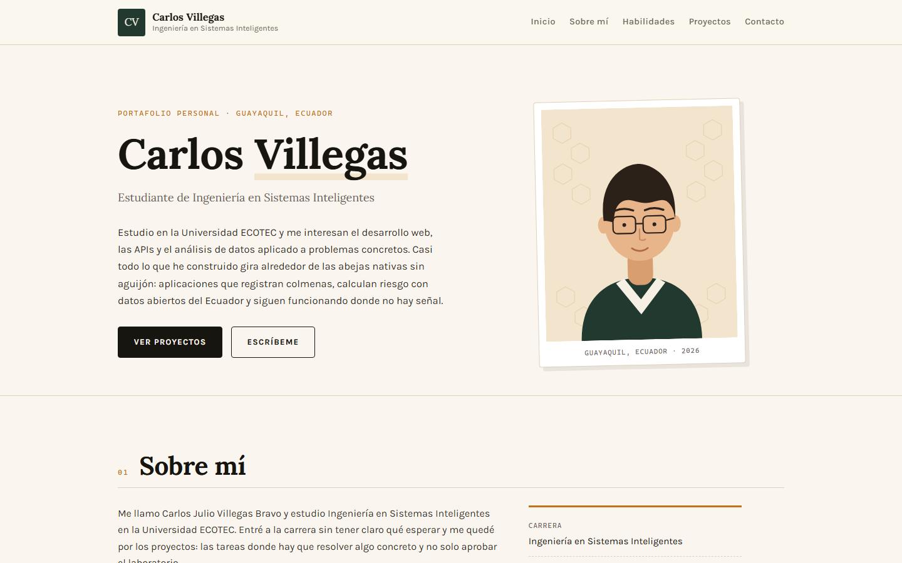

# Portafolio personal — Carlos Villegas

Sitio web de portafolio personal desarrollado para la asignatura **Programación de
Sistemas Web** de la **Universidad ECOTEC**.

- **Estudiante:** Carlos Julio Villegas Bravo
- **Carrera:** Ingeniería en Sistemas Inteligentes
- **Universidad:** Universidad ECOTEC, Guayaquil (Ecuador)



## Descripción

Portafolio de una sola página que reúne mi presentación, mis habilidades, tres
proyectos en los que he trabajado y un formulario de contacto. Está construido
únicamente con HTML y CSS: no usa frameworks, preprocesadores ni JavaScript, así
que se puede abrir directamente desde el archivo `index.html` sin instalar nada.

El diseño parte de una paleta cálida (papel, tinta y miel) y de una tipografía
serif para los títulos, elegida porque la mayoría de mis proyectos están
relacionados con la meliponicultura. Las ilustraciones de los proyectos son SVG
hechos a mano, así que el sitio no depende de imágenes externas.

## Tecnologías utilizadas

- **HTML5** — estructura semántica con `header`, `nav`, `main`, `section`,
  `article`, `figure` y `footer`.
- **CSS3** — variables en `:root`, flexbox, pseudoclase `:hover`, transiciones y
  media queries para celular y tableta.
- **SVG** — avatar, favicon e ilustraciones de los proyectos dentro de `img/`.
- **Google Fonts** — tipografías Lora (títulos) y Karla (texto).
- **Git y GitHub** — control de versiones con commits por avance.

## Estructura del proyecto

```
portafolio-carlos-villegas/
├── index.html
├── styles.css
├── README.md
└── img/
    ├── avatar.svg
    ├── captura-portafolio.png
    ├── favicon.svg
    ├── proyecto-api.svg
    ├── proyecto-melioraculo.svg
    └── proyecto-sed.svg
```

## Cómo visualizar el proyecto

1. Clona el repositorio:

   ```bash
   git clone https://github.com/carlosvillegas2733-rgb/portafolio-carlos-villegas.git
   ```

2. Entra a la carpeta y abre `index.html` con doble clic en cualquier navegador.
   No hace falta servidor web ni instalar dependencias.

3. Si prefieres levantarlo con un servidor local:

   ```bash
   python -m http.server 8000
   ```

   Y abre <http://localhost:8000> en el navegador.

## Contenido del sitio

| Sección | Contenido |
| --- | --- |
| Encabezado | Nombre, carrera y menú de navegación |
| Inicio | Título principal, descripción personal, avatar y accesos |
| Sobre mí | Presentación, intereses y objetivos académicos |
| Habilidades | Seis habilidades con su nivel real de manejo |
| Proyectos | MeliOráculo, SED y la API de trazabilidad, con imagen y enlace |
| Contacto | Formulario demostrativo (nombre, correo y mensaje) y datos directos |
| Pie de página | Nombre, año y enlace al perfil de GitHub |

## Autor

Carlos Julio Villegas Bravo — 2026
